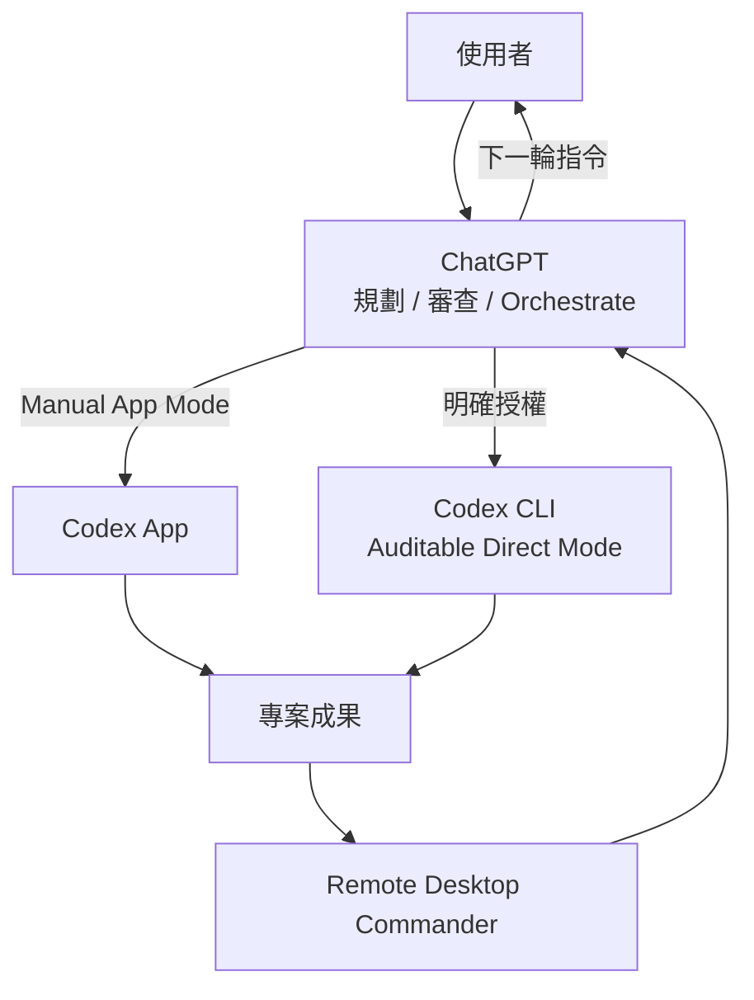

# ChatGPT Remote Codex Workflow

這是一套通用的 ChatGPT + Codex + Remote Desktop Commander 協作流程。

核心目的不是「讓 ChatGPT 偷偷在背景操作 Codex」，而是：

**省掉人工搬運截圖，同時保留額度控制、模型選擇、執行紀錄與長期可追溯性。**

這套流程分成三種模式：

1. **Manual App Mode**：ChatGPT 給指令，使用者貼進 Codex App。
2. **Review-only Remote Mode**：Codex 做完後，ChatGPT 透過 Remote Desktop Commander 直接讀成果。
3. **Auditable Direct CLI Mode**：使用者明確授權時，ChatGPT 可直接啟動 Codex CLI，但每次都必須鎖定模型／thinking effort，並留下完整 run 紀錄。

這不是 Blender 專用流程，可套用程式、CAD、資料分析、文件、研究、自動化、QA、部署等任何本機 Agent 專案。

## 5 分鐘快速開始

1. 工作電腦先安裝 Node.js 18+。
2. 啟動 Remote Desktop Commander：
   ```powershell
   npx @wonderwhy-er/desktop-commander@latest remote
   ```
3. 在瀏覽器完成裝置配對，並保持 remote process 持續執行。
4. 在 ChatGPT 連接 Remote Desktop Commander。
5. 先用測試資料夾驗證：列出檔案 → 建立文字檔 → 再讀回。
6. 第一個正式任務先使用 **Manual App Mode**。
7. Codex 完成後，只要回 ChatGPT：「Codex 做完了。」
8. ChatGPT 進入 **Review-only Remote Mode**，直接驗收真實專案成果。

完整安裝步驟見 [QUICKSTART.md](QUICKSTART.md)。

## 架構



重點：**審查成果，不等於自動再啟動一次 Codex。**

## 建議的預設工作流

```text
你和 ChatGPT 討論
        ↓
ChatGPT 指定 Codex 模型 + thinking effort
        ↓
ChatGPT 產生執行指令
        ↓
你貼給 Codex App
        ↓
Codex 執行並把成果寫入專案
        ↓
你只說：「Codex 做完了」
        ↓
ChatGPT 直接從電腦讀成果
        ↓
Pass / refinement / blocked / 需要你判斷
        ↓
下一輪指令
```

新流程主要省掉的是「Codex 截圖 → 人工傳回 ChatGPT」這一步。
## 可選的 Direct CLI

如果你明確授權，ChatGPT 可以透過 Remote Desktop Commander 直接啟動 Codex CLI。

但 Direct CLI 必須是**可稽核模式**：

- 每次明確指定 Codex 模型
- 每次明確指定 thinking / reasoning effort
- 保存本輪 prompt
- 保存 JSONL 執行事件
- 保存 Codex 最終回覆
- 保存 stderr / 錯誤
- 保存 git status / diff / commit 資訊
- 每次建立獨立 run-id 資料夾

不能因為 Remote Desktop Commander 可以執行 Terminal，就在沒有授權的情況下自動啟動 Codex。
## 分工

### ChatGPT
- 預設擔任大腦、規劃者、審查者與 orchestrator
- 每次執行前先選 Codex 模型與 thinking effort
- 產生可以直接交給 Codex 的指令
- Codex 完成後直接驗收真實檔案
- 只有獲得授權才可切換到 Direct CLI

### Codex
- 預設擔任本機執行者
- 可操作程式、MCP、CAD、Blender、資料與檔案
- 重要結果要落地，不只留在聊天視窗
- 困難任務也可以被授權擔任共同規劃者

### Remote Desktop Commander
- 讓 ChatGPT 存取已授權工作機
- 負責讀檔、Terminal、process、結果驗收
- 讓使用者不再當「ChatGPT ↔ Codex」的人肉傳檔員
## 長期延續性

建議分層保存：

- **AGENTS.md**：長期固定規則
- **HANDOFF.md**：目前專案狀態與下一步
- **review / QA**：每輪工程判斷與驗證
- **agent-runs/**：CLI 執行的完整稽核紀錄
- **Git commit**：重要里程碑

CLI 沒有 Codex App 對話畫面，不代表沒有紀錄；真正可靠的做法是把執行紀錄跟專案一起保存。

詳細說明：
- [QUICKSTART.md](QUICKSTART.md)
- [docs/codex-workflow.md](docs/codex-workflow.md)
- [docs/auditable-cli.md](docs/auditable-cli.md)
- [去識別化範例 run](examples/sample-run/README.md)
- [skill/SKILL.md](skill/SKILL.md)
